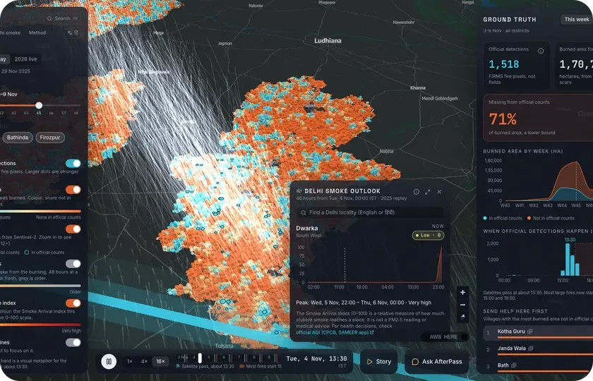
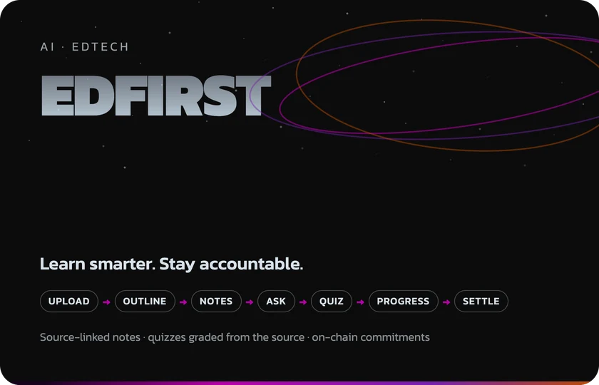
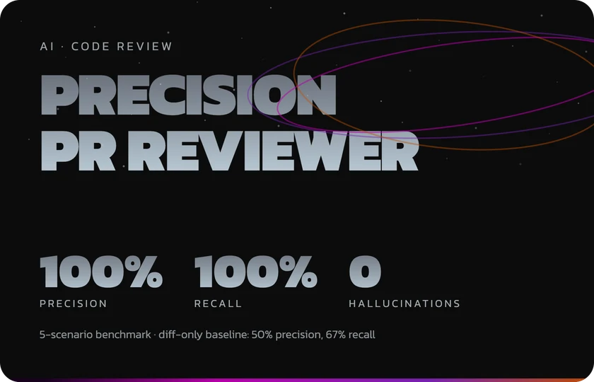
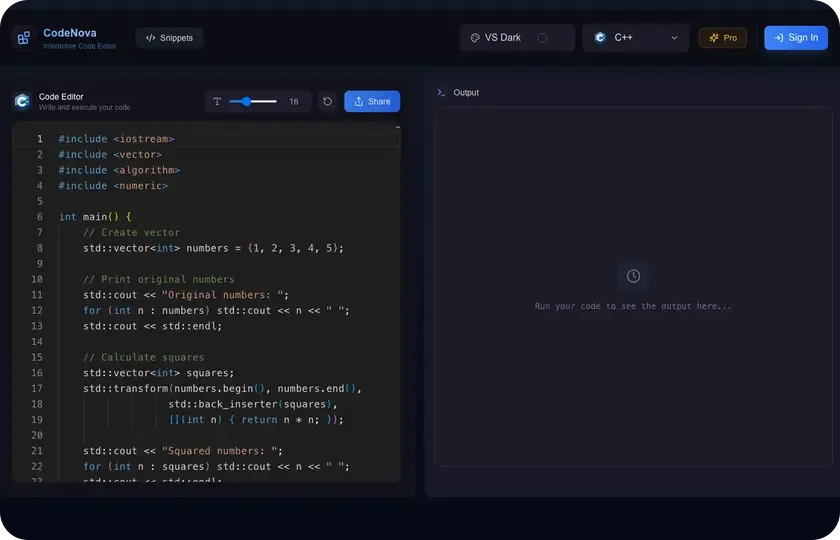
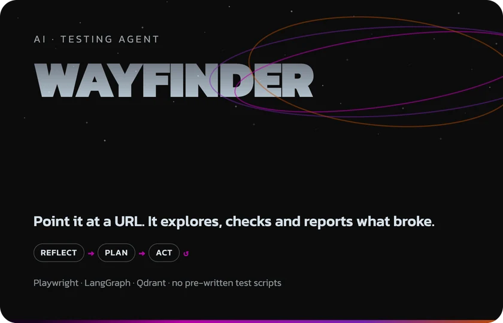
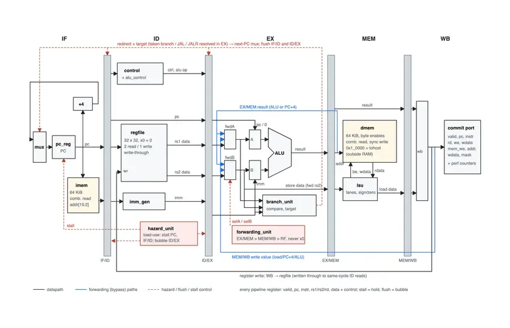

  <picture>
    <source media="(prefers-color-scheme: dark)" srcset="https://readme-typing-svg.demolab.com?font=Kanit&weight=500&size=22&duration=2600&pause=1400&color=D7E2EA&center=true&vCenter=true&width=720&lines=LeetCode+Knight+%C2%B7+Codeforces+Specialist;Ericsson+Edge+Academia+2.0+%C2%B7+Top+700;National+finalist+%C2%B7+TVS+Credit+E.P.I.C+7.0;Building+AI+agents%2C+RAG+apps+and+cloud+IDEs"/>
    
  </picture>

  
  
  
  
  
  
  

Electronics & Communication (IoT) undergrad at **Netaji Subhas University of Technology, Delhi** (class of 2027).

I build AI-powered web apps with Next.js, Node.js and PostgreSQL, and solder the occasional board on the side. So far I've been stonewalled by a Div 2 D at 2 a.m., talked into a wrong answer by my own RAG pipeline, and out-argued by an 865 MHz signal chain. Two of three eventually lost.

**[→ Everything I've built, on my portfolio](https://portfolio-seven-zeta-lxq62pv9m1.vercel.app)**

---

## Currently

**[Viva](https://github.com/kamboj-sajan/Viva)** — an AI interviewer that reads your GitHub repo, asks what a sharp senior engineer would, and grades your spoken answers against the actual code (milestone 1 of 6).

**System design & LLD** — going deep on distributed systems, scaling and caching, plus design patterns and OOP, while grinding contests on LeetCode and Codeforces.

**Chipless RFID reader (865 MHz)** — designing the reader PCB in KiCad around an ADF4351 synthesizer, an AD8302 gain/phase detector, an STM32 and an ESP32.

**Verilog protocol controllers** — UART + SPI/I²C controllers with a self-checking testbench.

---

## Featured projects

<table>
  <tr>
    <td width="50%" valign="top">
      
      <h3><a href="https://github.com/kamboj-sajan/Afterpass">AfterPass</a></h3>
      Finds the Punjab stubble fires that official satellite counts miss, forecasts where the smoke goes over Delhi, and answers questions in English and Hindi. Built for WeMakeDevs × AWS Environmental Hacks.
        
      <code>Python</code> <code>React</code> <code>AWS Lambda</code> <code>Step Functions</code> <code>Bedrock</code>
        
      <a href="https://main.dx6zgy1knro1d.amplifyapp.com"><b>Live</b></a> · <a href="https://github.com/kamboj-sajan/Afterpass">Code</a>
    </td>
    <td width="50%" valign="top">
      
      <h3><a href="https://github.com/kamboj-sajan/Edfirst">EdFirst</a></h3>
      Turns lecture videos and PDFs into a study workspace: source-linked notes, quizzes graded from the source, and a tutor that only answers from your material — with learning commitments escrowed on-chain.
        
      <code>Next.js</code> <code>Express</code> <code>TypeScript</code> <code>pgvector</code> <code>Gemini</code> <code>Solidity</code> <code>Docker</code>
        
      <a href="https://github.com/kamboj-sajan/Edfirst"><b>Code</b></a>
    </td>
  </tr>
  <tr>
    <td width="50%" valign="top">
      
      <h3><a href="https://github.com/kamboj-sajan/Precision-PR-Reviewer">Precision PR Reviewer</a></h3>
      AI pull-request reviewer that pairs Tree-sitter AST queries with a ChromaDB call-graph index, so it sees callers in untouched files instead of flagging phantom bugs.
        
      <code>FastAPI</code> <code>Node.js</code> <code>LangChain</code> <code>Tree-sitter</code> <code>ChromaDB</code> <code>MongoDB</code>
        
      <a href="https://github.com/kamboj-sajan/Precision-PR-Reviewer"><b>Code</b></a>
    </td>
    <td width="50%" valign="top">
      
      <h3><a href="https://github.com/kamboj-sajan/codenova">CodeNova</a></h3>
      Cloud IDE with isolated code execution in 10+ languages, a Monaco editor, real-time snippet sharing and a webhook-driven Pro tier.
        
      <code>Next.js 15</code> <code>TypeScript</code> <code>Convex</code> <code>Monaco</code> <code>Clerk</code>
        
      <a href="https://codenova-sigma.vercel.app"><b>Live</b></a> · <a href="https://github.com/kamboj-sajan/codenova">Code</a>
    </td>
  </tr>
  <tr>
    <td width="50%" valign="top">
      
      <h3><a href="https://github.com/kamboj-sajan/Wayfinder">Wayfinder</a></h3>
      Autonomous testing agent: point it at a URL and it explores the app in a real browser, checks invariants after every action and replays the run as a state graph.
        
      <code>TypeScript</code> <code>LangGraph</code> <code>Playwright</code> <code>Qdrant</code> <code>Azure</code>
        
      <a href="https://drive.google.com/file/d/1-7oueO3SMrvWXI1vLhPWmnbxOXuc2fpt/view?usp=sharing"><b>Demo</b></a> · <a href="https://github.com/kamboj-sajan/Wayfinder">Code</a>
    </td>
    <td width="50%" valign="top">
      
      <h3><a href="https://github.com/kamboj-sajan/Risc-V">RV32I Pipelined Core</a></h3>
      A 5-stage pipelined RISC-V core with full forwarding and hazard handling, verified in lockstep against a Python reference ISS cross-checked with Spike. 147/147 tests pass.
        
      <code>SystemVerilog</code> <code>Verilator</code> <code>Python</code> <code>RISC-V</code>
        
      <a href="https://github.com/kamboj-sajan/Risc-V"><b>Code</b></a>
    </td>
  </tr>
</table>

**Also:**

- **[Nimbus](https://github.com/kamboj-sajan/Nimbus)** — real-time collaborative cloud IDE with a terminal, live preview and a Kubernetes runtime per user
- **[AskPDF](https://github.com/kamboj-sajan/AskPdf)** — RAG app to chat with your PDFs · [Live](https://askpdf-livid.vercel.app/)
- **[hwdiag](https://github.com/kamboj-sajan/hwdiag)** — Linux hardware diagnostics: cache and DRAM latency, STREAM bandwidth, perf counters
- **[NeuroPilot](https://github.com/kamboj-sajan/NeuroPilot)** — AI career coach with mock interviews and cover letters · [Live](https://neuro-pilot-rho.vercel.app)
- **[Cisco office network lab](https://github.com/kamboj-sajan/cisco-office-network-lab)** — two-site enterprise network: multi-area OSPF, eBGP failover, IPsec VPN
- **[LeetCode solutions](https://github.com/kamboj-sajan/leetcode)** — 1,200+ in C++

---

## Achievements

- **LeetCode Knight** — peak 2041, top 3% globally · 780+ problems solved
- **Codeforces Specialist** (peak 1456) · **CodeChef** max rating 1626
- Selected in the **Top 700** for the **Ericsson Edge Academia Program 2.0** (5G, AI, IoT, Telecom)
- **National Finalist**, TVS Credit E.P.I.C 7.0 Challenge
- **Google Cloud Gen AI Academy APAC 2026** — built and deployed AI agents on Cloud Run
- **WeMakeDevs × AWS Environmental Hacks** — built AfterPass (Bharat Builds Tour, Air track)

---

## Toolbox

**Languages** 

**Frontend & Backend** 

**Data & AI** 

**Cloud & Tools** 

**Hardware** 

---

## Activity

  

  <picture>
    <source media="(prefers-color-scheme: dark)" srcset="https://raw.githubusercontent.com/kamboj-sajan/kamboj-sajan/output/github-snake-dark.svg"/>
    <source media="(prefers-color-scheme: light)" srcset="https://raw.githubusercontent.com/kamboj-sajan/kamboj-sajan/output/github-snake.svg"/>
    
  </picture>

