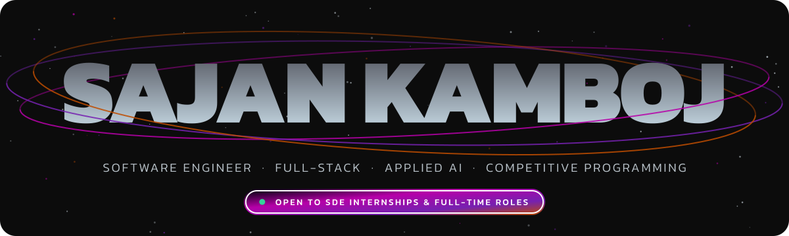

  

<h1 align="center">Sajan Kamboj</h1>

  <b>Software Engineer</b> &nbsp;·&nbsp; Full-stack, Applied AI and Competitive Programming

<h3 align="center">
  
</h3>

  
  
  
  
  
  

Electronics & Communication (IoT) undergrad at **Netaji Subhas University of Technology, Delhi** (class of 2027).

I build AI-powered web apps with Next.js, Node.js and PostgreSQL, and solder the occasional board on the side. So far I've been stonewalled by a Div 2 D at 2 a.m., talked into a wrong answer by my own RAG pipeline, and out-argued by an 865 MHz signal chain. Two of three eventually lost.

---

## Currently

**System design & LLD** — going deep on distributed systems, scaling and caching, plus design patterns and OOP, while grinding contests on LeetCode and Codeforces.

**Chipless RFID reader (865 MHz)** — designing the reader PCB in KiCad around an ADF4351 synthesizer, an AD8302 gain/phase detector, an STM32 and an ESP32.

**Verilog protocol controllers** — UART + SPI/I²C controllers with a self-checking testbench.

---

## Featured Projects

| Project | What it is | Stack | Links |
|---|---|---|---|
| **[EdFirst](https://github.com/kamboj-sajan/Edfirst)** | Turns lecture videos and PDFs into a study workspace: source-linked notes, auto-generated quizzes, a citation-grounded AI tutor, and on-chain learning commitments | Next.js, Express, TypeScript, PostgreSQL + pgvector, Gemini, Solidity, Docker | |
| **[CodeNova](https://github.com/kamboj-sajan/codenova)** | Cloud IDE with isolated code execution in 10+ languages, real-time snippet sharing, and a webhook-driven Pro tier | Next.js 15, TypeScript, Convex, Monaco, Clerk, Lemon Squeezy | [Live](https://codenova-sigma.vercel.app) |
| **[AskPDF](https://github.com/kamboj-sajan/AskPdf)** | RAG app to chat with your PDFs: LangChain chunking and vector search, persistent multi-document chat sessions | React, TypeScript, Express, LangChain, Gemini, PostgreSQL, Redis | [Live](https://askpdf-livid.vercel.app/) |
| **[Medify](https://github.com/kamboj-sajan/medify)** | Doctor appointment booking platform | JavaScript, Next.js | |

---

## Achievements

- **LeetCode Knight** — peak 2041, top 3% globally · 750+ problems solved
- **Codeforces Specialist** (peak 1437) · **CodeChef** max rating 1626
- Selected in the **Top 700** for the **Ericsson Edge Academia Program 2.0** (5G, AI, IoT, Telecom)
- **National Finalist**, TVS Credit E.P.I.C 7.0 Challenge
- **Google Cloud Gen AI Academy APAC 2026** — built and deployed AI agents on Cloud Run

---

## Toolbox

**Languages** 

**Frontend & Backend** 

**Data & AI** 

**Cloud & Tools** 

**Hardware** 

---

## Stats

  
  

  

